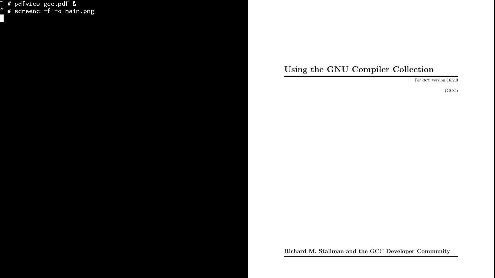

# pdfview

Minimal C89 PDF viewer for X11 with vi keybindings. Pages are rendered by Poppler (`pdftoppm`, `pdfinfo`) and drawn with plain Xlib. No cairo.

## Dependencies

   poppler-utils libx11-dev 

## Build

    make

## Usage

    ./pdfview file.pdf

## Keys

| Key | Action |
|---|---|
| h / l / k / j | Pan left / right / up / down |
| Shift+h / Shift+l | Previous / next page |
| + / - | Zoom in / out |
| 0 | Reset zoom |
| q / Esc | Quit |

## Behavior

- Temporary files are written to `/tmp/pdfview.<pid>.*` and removed after use.
